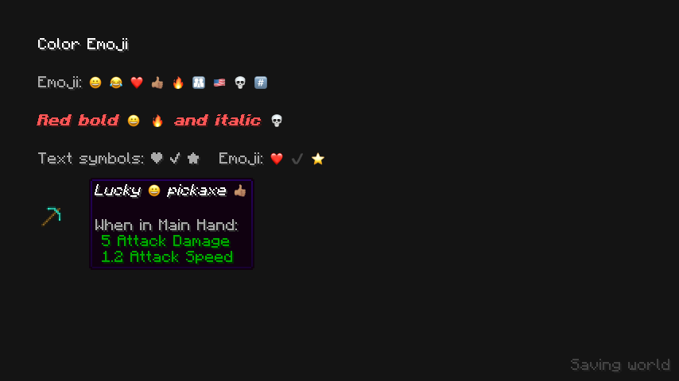
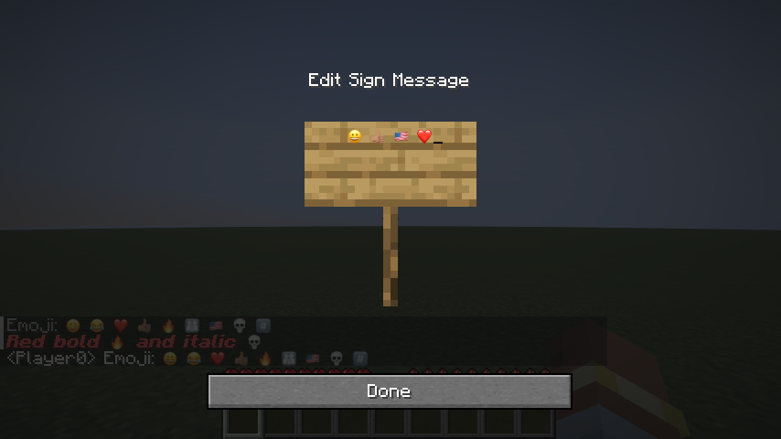

# Color Emoji

A standalone, client-only Fabric mod for **Minecraft 26.2** that draws emoji
in full color using Apple's emoji artwork.



Emoji work in chat, signs, named items, tooltips, and other text using
Minecraft's default font. Skin tones (👍🏽), flags (🇺🇸), families (👨‍👩‍👧),
hearts (❤️), and keycaps (#️⃣) each render as one emoji. Colors stay intact
even in gray, red, bold, or italic text.

Text symbols such as ❤, ✔, and ★ keep Minecraft's appearance unless written
as emoji with a variation selector. Chat messages, copied text, sign text,
and item names keep their original Unicode characters.

## Install

1. Use Minecraft **26.2**, Java **25**, and Fabric Loader **0.19.3 or newer**.
2. Download `color-emoji-1.0.0+26.2.jar` from [Releases](https://github.com/Merkie/color-emoji/releases).
3. Put it in your Minecraft instance's `mods` folder and restart the game.

Color Emoji is active automatically. Fabric API and server installation are
not required. The emoji images ship inside the JAR; the mod makes no network
requests. Only one version of Color Emoji should be installed at a time.

Custom resource-pack fonts that replace the default font's Unicode fallback
may override emoji rendering.



## Build and test

With JDK 25 selected:

```sh
./gradlew --no-daemon build
./gradlew --no-daemon runClientGameTest
```

On Linux, run client tests with `xvfb-run -a`. On macOS, the test window stays
hidden and muted. Tests create disposable local worlds and exercise emoji
widths, unchanged text, chat, sign editing, and named-item tooltips.

The installable JAR is `build/libs/color-emoji-1.0.0+26.2.jar`. The
`-sources.jar` is for development. Fabric API is used only by the test harness.
Screenshots are saved under `build/run/clientGameTest/screenshots/`.

## Emoji images

The JAR contains 3,508 emoji images at 40 pixels, loaded as needed and scaled
to the current GUI scale. `tools/emoji.py` generates the images and sequence
index from an Apple emoji font and Unicode's emoji test data; its docstring
contains the regeneration command and Python dependencies.

Apple owns the emoji artwork. See [NOTICE.md](NOTICE.md) for its source and
[LICENSE](LICENSE) for the project's license.
